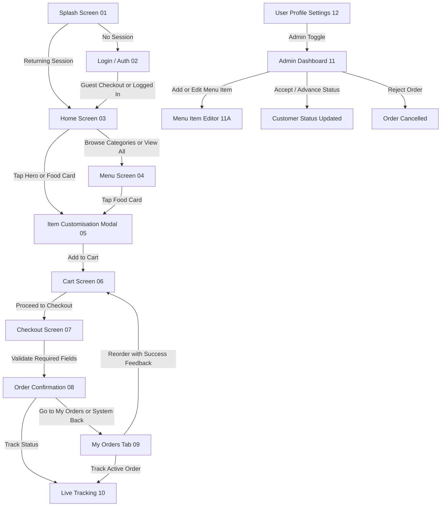

# RastasperiQ — Design & Brand Architecture

This document serves as the single source of truth for the **Peri Q** mobile application design system, screen architecture, user flows, and implementation guide. It connects the high-fidelity screens generated within the **Stitch Project** with a concrete technical blueprint for development.

---

## 1. Project Overview & Stitch Metadata

* **Stitch Project Name**: `RastasperiQ — Food Ordering App`
* **Stitch Project ID**: `projects/10136017228007500213`
* **Design System Asset**: `assets/16885437860906962396`
* **Target Platforms**: Android (Primary) and iOS (Responsive Modern Layouts)
* **Visual Theme**: Vibrant Chesa Nyama street-food energy meets high-end premium modern UI.

---

## 2. Brand Identity & Design System

The design system establishes a warm, appetizing, and bold theme inspired by glowing embers, flame-grilling, and South African township braai culture.

### Color Palette
| Token | Color | Hex Code | Usage |
| :--- | :--- | :--- | :--- |
| **Primary** | Peri Red | `#C8240B` | Fiery accent, active indicators, primary CTAs, main logo text. |
| **Secondary** | Chesa Orange | `#F07820` | Braai ember highlights, ratings, active status progress. |
| **Neutral Dark** | Smoke Charcoal | `#1A1A1A` | Main headers, text, dark backgrounds, high contrast elements. |
| **Neutral Muted** | Ash Grey | `#4A4A4A` | Secondary text, icons, borders, dividers. |
| **Background** | Cream White | `#FFF8F5` | Main app background (warm, clean, food-centric). |
| **Surface** | Light Surface | `#FFFFFF` | Menu cards, dialogs, summaries. |
| **Surface Accent** | Muted Surface | `#F5F0ED` | Inactive controls, search inputs, text area backdrops. |

### Semantic Colors
* **Success**: `#2A8C5A` (Store "Open", Order "Ready" state, available items)
* **Warning**: `#E8A400` (Pending approvals, intermediate status)
* **Error**: `#C8240B` (Out of stock, failed payment)

### Typography
We pair the high-impact energy of **Oswald** for headlines with the clean, friendly, and readable **Nunito Sans** for transactional copy.

* **Display Title**: Oswald Bold 32px (Splash screen, primary headings)
* **H1**: Oswald SemiBold 28px (Welcome headers)
* **H2**: Oswald SemiBold 22px (Main categories, profile name)
* **H3 / Card Header**: Oswald Medium 18px (Food item titles, order numbers)
* **Body Large**: Nunito Sans Regular 16px (Primary descriptions, details)
* **Body Medium**: Nunito Sans Regular 14px (Secondary/metadata text)
* **Body Small**: Nunito Sans Regular 12px (Helper copy, disabled labels)
* **Price Tag**: Oswald Bold 20px in **Peri Red** (Vibrant pricing focus)

### Component Styles
1. **Buttons**:
   * *Primary*: 48px height, 8px corner radius (`ROUND_EIGHT`), solid `#C8240B` fill, white text, bold font.
   * *Secondary / Outline*: White background, 1px `#C8240B` border, red text.
   * *Disabled*: Grey `#BEBEBE` background, white text.
2. **Cards**:
   * *Food card*: White background, 12px corner radius, soft ambient shadow (`0 2px 12px rgba(0,0,0,0.08)`), horizontal layout for compact lists, grid layout for featured showcases.
3. **Input Fields**:
   * 56px height, `#F5F0ED` fill, 8px radius, no border by default. Focused state displays a thin `#C8240B` bottom highlight.

---

## 3. Screen-by-Screen Architecture

The implemented app keeps the original 12 high-fidelity core screens from the **Stitch project** and adds an owner-side menu editor utility to complete the admin flow.

### 01. Splash Screen
* **Concept**: Rich, dark, atmospheric, premium.
* **UI Elements**: 
  * Full-screen deep charcoal backdrop (`#1A1A1A` to `#0D0D0D`).
  * Soft red-orange ember glow rising from bottom-center.
  * Centered full business logo: Fiery grill icon in Peri Red, `RASTA'S` (Oswald tracker uppercase), `PERI Q` (Oswald Bold 48px), `CHESANYAMA` (Oswald spaced tracking).
  * Tagline: *"Authentically Grilled. Delivered Hot."*
  * Bottom animated thin loading bar (`#C8240B`).
  * Session-aware routing: returning users continue directly to Home; new or signed-out users continue to Login / Auth.

### 02. Login / Authentication Screen
* **Concept**: Simple, friction-free onboarding.
* **UI Elements**:
  * Light cream backdrop (`#FFF8F5`).
  * Upper-left compact brand identifier (`Peri Q`).
  * Toggle tab switcher: `Phone Number` (active) | `Email`.
  * Mobile input with country selector (`+27` flag selector) and full phone validation.
  * Bottom alternate logins: Google, "Continue as Guest" link (prominent for instant ordering).
  * Successful sign-in or guest entry creates a returning session and routes into the customer shell on Home.

### 03. Home Screen
* **Concept**: Appetizing dashboard optimized for quick ordering.
* **UI Elements**:
  * Top app bar: `Peri Q` logo on left, green glowing `Open Now • Closes 9PM` storefront badge, shopping cart badge `(3)` on right.
  * Hero promo slider: Dark glowing card displaying today's hot deal *"Flame-Grilled Chicken Kota R65"* with an *"Order Now"* CTA that opens Item Detail / Customisation.
  * Horizontal Category pills: `All`, `Kota`, `Pap & Meat`, `Burgers`, `Drinks`, `Desserts`; selecting a pill opens the Menu screen with that filter active.
  * Featured Grid: Dual column cards with large high-definition pictures, name, short description, red price tag, tap-to-open customisation, and quick-add `+` button for instant cart add.
  * Today's Specials: Full-bleed list items with tap-to-open customisation and a right-aligned *"Add"* button for quick add.
  * Sticky Bottom Navigation.

### 04. Full Menu Screen
* **Concept**: Filterable list for deep browsing.
* **UI Elements**:
  * Top search input field with live filter function.
  * Clean category selector bar (active tab underlined in Peri Red).
  * Grouped food lists categorized by `Kota`, `Pap & Meat`, etc.
  * Horizontal list cards showing item image on left, item details & stock status green dot in the middle, and price + quick-add action on the right.
  * Tapping a menu card opens Item Detail / Customisation; tapping the compact add action stays as Quick Add.
  * Sticky Floating Cart Banner: *"1 item in cart • R65"* with a click action to *"View Cart"*.

### 05. Food Item Detail / Customisation Modal
* **Concept**: Interactive bottom sheet customization.
* **UI Elements**:
  * Slides up overlay occupying 85% of screen height.
  * Full-bleed header image of the food.
  * Detailed ingredients text, caloric tag, and price.
  * Customize group 1: Radio buttons for Spice Level (`Mild`, `Medium`, `Hot`, `Extra Hot`).
  * Customize group 2: Add-on checkboxes (`Extra Sauce +R5`, `Extra Chips +R10`).
  * Custom store notes text area box.
  * Large sticky bottom Add CTA containing quantity adjustments.
  * On add: item is inserted into cart and the user is taken directly to the Cart screen.

### 06. Cart Screen
* **Concept**: Clean review of items.
* **UI Elements**:
  * Card rows detailing chosen items, selected spice levels, custom add-ons, and pricing.
  * Quick swipe-to-delete item action with visual feedback.
  * *"Add More Items"* outlined secondary CTA.
  * Total calculation block: Subtotal, delivery fee, final total (`R319`).
  * Big red *"Proceed to Checkout"* button.
  * Serves as the dedicated review step after customisation before checkout begins.

### 07. Checkout Screen
* **Concept**: Secure, fast transactional layout.
* **UI Elements**:
  * Top progress indicators for `Details`, `Fulfilment`, and `Payment`.
  * User details container (pre-filled fields for name, number).
  * Order Type Selector: Card boxes with active radio buttons:
    * `Pickup in Store` (selected, details ready in 25 mins).
    * `Home Delivery` (adds +R30, opens delivery address form below).
  * Payment Type List: Selectable items with icons: `Cash on Collection`, `Cash on Delivery`, `EFT proof upload`, `Card payment (Coming Soon)`.
  * Sticky *"Place Order • R319"* bottom button.
  * Validation rules: name and phone are required; delivery address is required for `Home Delivery`; invalid payment combinations are reset when switching back to pickup.

### 08. Order Confirmation Screen
* **Concept**: Gratifying and transparent order landing page.
* **UI Elements**:
  * Large green victory checkmark overlay with red and orange confetti design.
  * Title: *"Order Placed! Thanks, Thabo."*
  * Receipt info card: Summary of order number (`#1047`), selected pickup details, payment method, items list.
  * Vertical visual status tracking pipeline showing the first state (*"Order Received"*) checked off.
  * Primary actions: `Track Order` or `Go to My Orders`.
  * Navigation safeguard: system back returns to the customer shell instead of an emptied cart.

### 09. My Orders Screen (History & Live Check)
* **Concept**: Consolidated customer order overview.
* **UI Elements**:
  * Active orders list: Shows cards for running orders (e.g. `#1047` in `PREPARING` orange status, `#1046` in `PENDING` amber status).
  * In-card inline horizontal progress bar tracker.
  * Order history section: Completed and cancelled cards remain visible with quick *"Reorder ↺"* option.
  * Reorder action adds items back to cart, shows visible success feedback, and opens the Cart screen.

### 10. Live Tracking Screen
* **Concept**: High-fidelity live status detail page.
* **UI Elements**:
  * Fiery orange-red gradient top panel displaying: *"PREPARING YOUR ORDER • Est. 18 mins remaining"*.
  * Detailed vertical progress timeline containing real-time updates and active kitchen status.
  * Detailed store address box with a single-click phone dial action: *"Call soweto branch directly"*.

### 11. Owner / Admin Dashboard
* **Concept**: Simplified management tool for store operators.
* **UI Elements**:
  * Top dark header with a prominent active/inactive toggle switcher: *"Store Open 🟢"*.
  * Daily metrics dashboard: `Active Orders: 5`, `Today's Sales: R2,450`, `Completed: 18`.
  * Incoming Orders queue (sorted by priority): Large card displays with item lists, custom requests highlighted in yellow (e.g. *"No onions, extra sauce"*), pickup type, and big tactile buttons: `[Reject]` (grey) and `[Accept & Start Cooking 🔥]` (red).
  * `Reject` moves the order out of the active queue as cancelled; `Accept`, `Mark Ready`, and `Mark Completed` advance the real status shown to the customer.
  * Persistent plus FAB (`+`) opens the menu item editor; existing menu rows also expose `Edit`.

### 11A. Menu Item Editor
* **Concept**: Lightweight admin utility for mock menu management.
* **UI Elements**:
  * Form fields for item name, description, price, category, image preset, and availability.
  * Preview image at the top for quick visual verification.
  * Primary save action for both add and edit flows.

### 12. User Profile / Settings Screen
* **Concept**: High-end user space.
* **UI Elements**:
  * Bold charcoal profile banner displaying avatar, user stats, phone, and email.
  * Card-grouped rows: `Saved Addresses`, `Payment Preferences`, `Language`, `Push Notifications`.
  * Specialized highlighted row: `Switch to Admin Portal` (secure access route).
  * Centered ash grey `Sign Out` button that clears the returning session and routes back to Login / Auth.

---

## 4. User Interaction Flows



---

## 5. Technical Implementation Roadmap

To align with the recommended stack in the brief, the following framework architecture is suggested:

### Frontend: Flutter (Android & iOS)
* **Routing**: Use `go_router` or native Navigator for clean modal sheet transitions (especially Screen 05 bottom customization drawer).
* **State Management**: Use `Riverpod` or `Bloc` to manage cart states asynchronously and maintain fluid, low-data footprint updates.
* **Session Continuity**: Maintain a lightweight persisted local session so the Splash screen can restore returning users directly into Home while backend auth is still being connected.
* **Real-time Status Updates**: Integrate Supabase PostgreSQL `Realtime` subscriptions on the `orders` table to dynamically transition indicators on Screens 08, 09, and 10 when the store modifies the state from the Admin Dashboard (Screen 11).

### Backend: Supabase (PostgreSQL + Auth + Storage)
* **Auth**: Use Supabase Auth with anonymous guest check-in enabled (`client.auth.signInAnonymously()`) to support guest checkout smoothly.
* **Database Tables**:
  ```sql
  -- Core Tables
  create table menu_items (
    id uuid primary key default gen_random_uuid(),
    name text not null,
    description text,
    price numeric not null,
    category text check (category in ('kota', 'pap_meat', 'burgers', 'drinks', 'desserts')),
    is_available boolean default true,
    image_url text
  );

  create table orders (
    id uuid primary key default gen_random_uuid(),
    order_number serial,
    user_id uuid references auth.users(id) on delete set null,
    customer_name text not null,
    customer_phone text not null,
    order_type text check (order_type in ('pickup', 'delivery')),
    delivery_address text,
    payment_method text check (payment_method in ('cash_collection', 'cash_delivery', 'eft')),
    total_price numeric not null,
    status text check (status in ('pending', 'preparing', 'ready', 'completed')) default 'pending',
    created_at timestamp with time zone default now()
  );
  ```

### Push Notifications: Firebase Cloud Messaging (FCM)
* Bind FCM device tokens to customer user records on startup.
* Trigger standard automated cloud functions upon `orders.status` state changes to push notifications directly to user phones.
